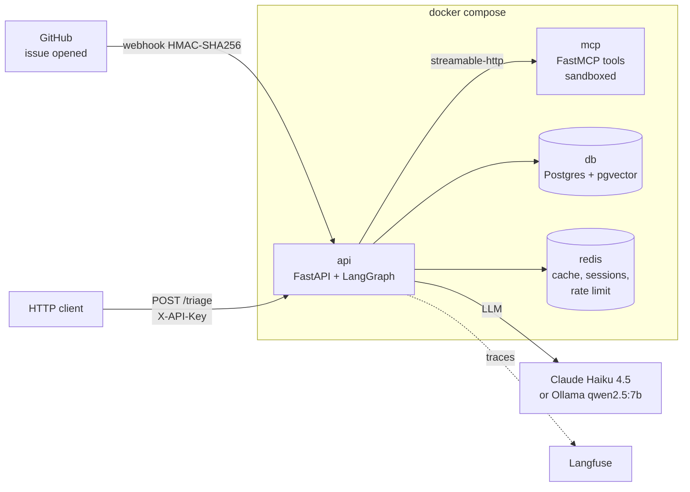

# IssueTriage AI

[](https://github.com/loky98/IssueTriage-AI/actions/workflows/ci.yml)

An AI agent that triages new GitHub issues for [`pandas-dev/pandas`](https://github.com/pandas-dev/pandas). Given an issue, it:

- **classifies** it as `Bug`, `Docs`, `Enhancement` or `Usage Question`;
- finds **similar or duplicate issues** and the **relevant documentation section** (RAG over pgvector);
- **runs the code snippet** from the report in a sandbox to compare expected vs. actual behavior;
- can call **tools** through its own MCP server (search GitHub, read an issue);
- returns **structured JSON** with cited sources, a suggested reply and a `needs_human` flag.

It is exposed as a REST API (FastAPI) and as a GitHub webhook, runs entirely in Docker Compose, and is evaluated against issues that pandas maintainers already closed and labeled, a public ground truth.

## Results

| Metric | Value | Source |
|---|---|---|
| Classification accuracy | **90.0 %** | 40 held-out issues, 10 per label, `claude-haiku-4-5`, prompt v2 |
| Classification F1 (macro) | **0.899** | same run |
| Retrieval recall@5 | **76.65 %** | 167 duplicate → original pairs |
| Mean latency per issue | 19.2 s | same classification run |

Full reports, including confusion matrices: [`evals/results/`](evals/results/).

Two findings from the evals shaped the design:

- **Prompt and validation matter more than the model.** The first prompt (v1) with a local 7B model reached only 27.5 % accuracy, mostly because of outputs that broke the schema. Adding a structured-output retry and a validation step fixed that.
- **A reranker made retrieval worse.** Cross-encoder reranking dropped recall@5 from 76.65 % to 51.50 % (`ms-marco-MiniLM-L-6-v2`) and 41.32 % (`bge-reranker-base`), so it is not used.

## Architecture



The agent is a LangGraph graph with fixed steps and one bounded tool loop:

`retrieve → reproduce → investigate ⇄ tools (max 2 rounds) → draft → validate`

The `validate` step drops any cited URL that the agent did not actually retrieve, and flags the result for human review when confidence is low or the reply references unverified issues.

Design decisions (why pgvector, why LangGraph, why MCP, why no reranker) are documented as ADRs in [`docs/architecture.md`](docs/architecture.md).

## Tech stack

| Area | Tools |
|---|---|
| Agent | LangGraph, LangChain (`langchain-anthropic`, `langchain-ollama`) |
| LLM | Claude Haiku 4.5 (Anthropic API) or `qwen2.5:7b` (Ollama, local) |
| RAG | PostgreSQL 16 + pgvector (HNSW, cosine), `BAAI/bge-small-en-v1.5` embeddings |
| Tools | Model Context Protocol server (FastMCP) + `langchain-mcp-adapters` |
| API | FastAPI, Pydantic v2, API-key auth, Redis rate limiting |
| Memory / cache | Redis |
| Guardrails | Domain filter, PII masking, tool allow-list, schema validation with retry |
| Evaluation | scikit-learn (accuracy, macro F1, confusion matrix), custom recall@k |
| Observability | Langfuse |
| Delivery | Docker multi-stage builds, Docker Compose, GitHub Actions (ruff, pytest, image builds) |

## Getting started

### Prerequisites

- Docker Desktop
- Python 3.11
- A GitHub personal access token (public read access is enough)
- An Anthropic API key, **or** [Ollama](https://ollama.com) with `qwen2.5:7b` pulled

### 1. Configure

```bash
cp .env.example .env
```

Fill in at least `GITHUB_TOKEN`, `POSTGRES_PASSWORD`, `DATABASE_URL`, `API_KEYS` and `ANTHROPIC_API_KEY`. To use Ollama instead, set `LLM_PROVIDER=ollama`. Langfuse is optional: tracing turns on only when `LANGFUSE_SECRET_KEY` is set.

For local scripts, `DATABASE_URL` points to the published port, for example `postgresql://issuetriage:<password>@127.0.0.1:5432/issuetriage`. Inside Compose the API overrides it to reach the `db` container.

### 2. Start the database and Redis

```bash
docker compose up -d db redis
```

### 3. Build the index

The data is not committed: it is downloaded from public sources and indexed locally.

```bash
python -m venv .venv
source .venv/bin/activate          # Windows: .venv\Scripts\activate
pip install torch --index-url https://download.pytorch.org/whl/cpu
pip install -r requirements-api.txt -r requirements-dev.txt langchain-text-splitters

python -m ingest.fetch_issues      # closed, labeled issues → data/raw/issues.jsonl
git clone --depth 1 https://github.com/pandas-dev/pandas data/raw/pandas-repo
python -m ingest.fetch_docs        # user guide sections → data/processed/docs.jsonl
python -m ingest.fetch_duplicates  # duplicate → original pairs for the retrieval eval
python -m ingest.build_index       # chunks + embeddings → pgvector; holds out 200 issues for evals
python -m ingest.index_originals   # adds the original issues of the duplicate pairs
```

`build_index` writes the 200 held-out issues to `evals/dataset.jsonl` **before** indexing, with a stratified split, so the agent never retrieves the issue it is being evaluated on.

### 4. Run the full stack

```bash
docker compose up -d --build
```

The API is available at http://127.0.0.1:8000, with interactive OpenAPI docs at http://127.0.0.1:8000/docs.

### 5. Triage an issue

```bash
curl -X POST http://127.0.0.1:8000/triage \
  -H "X-API-Key: <one of your API_KEYS>" \
  -H "Content-Type: application/json" \
  -d '{"title": "read_csv ignores sep=\";\"", "body": "```python\nimport pandas as pd, io\nprint(pd.read_csv(io.StringIO(\"a;b\\n1;2\"), sep=\";\").shape)\n```\nI expected 2 columns but got 1."}'
```

The response follows the `TriageResult` schema in [`app/schemas.py`](app/schemas.py): `reasoning`, `label`, `confidence`, `duplicates`, `doc_refs`, `suggested_reply` and `needs_human`. Add `?session_id=<id>` to give the agent memory of earlier triages in the same session.

### API endpoints

| Method | Path | Description |
|---|---|---|
| `GET` | `/health` | Health check |
| `POST` | `/triage` | Synchronous triage. Requires `X-API-Key`; rate limited per key (`RATE_LIMIT_PER_MIN`) |
| `POST` | `/webhooks/github` | GitHub `issues` webhook. Verifies `X-Hub-Signature-256`, handles `opened` events and triages in the background (202) |

## Evaluation

```bash
python -m evals.run_evals --per-label 10 --prompt v2   # classification: accuracy, macro F1, confusion matrix
python -m evals.eval_retrieval                          # retrieval: recall@5 with and without reranker
```

Classification runs are resumable and write both raw predictions (`.jsonl`) and a Markdown report to `evals/results/`.

## Tests

```bash
pip install -r requirements-dev.txt
ruff check .
pytest                # unit and integration tests (agent and LLM mocked)
pytest -m eval        # live smoke eval on 5 real issues (needs the stack and an LLM; has a cost)
```

CI runs `ruff`, `pytest` and both Docker image builds on every pull request.

## Project structure

```
app/          FastAPI app, LangGraph agent, RAG, guardrails, schemas, Redis memory, versioned prompts
mcp_server/   MCP server exposing search_github_issues, get_issue and run_snippet
ingest/       Data download and indexing scripts
db/init/      pgvector schema (chunks table, HNSW index)
evals/        Held-out dataset, evaluation scripts and result reports
tests/        Unit and integration tests
scripts/      Manual smoke scripts used during development
docs/         Architecture and ADRs
```

## Security

- API-key authentication with constant-time comparison; rate limiting in Redis stores only a hash of the key.
- The GitHub webhook is verified with HMAC-SHA256.
- Issue text is treated as untrusted data in the prompt, PII (emails, GitHub/Anthropic/AWS keys) is masked before reaching the LLM, and only allow-listed tools can be called.
- Code from issues runs in a separate container (read-only filesystem, no capabilities, memory and process limits, 30 s timeout) with an empty environment, so it cannot read any secrets.

## Limitations

- **High `needs_human` rate (70 %).** The validation step is deliberately conservative: it prefers escalating to a maintainer over posting a doubtful answer.
- **`Usage Question` vs. `Bug`** is the main confusion (3 of 10 usage questions were classified as bugs).
- **Latency.** About 19 s per issue with Claude Haiku. The webhook absorbs it in the background, but `/triage` is synchronous.
- **Small evaluation sample.** The reported run uses 40 of the 200 held-out issues to keep cost low.
- **The live eval does not run in CI**, because it needs the indexed database and a paid LLM. CI covers the API with the agent mocked, plus unit tests of routing, schemas, guardrails and the sandbox.
- **Single repository.** The index, domain guardrail and tools are built for pandas.
- The keyword block-list in `run_snippet` can be bypassed; the real protection is the container sandbox.
