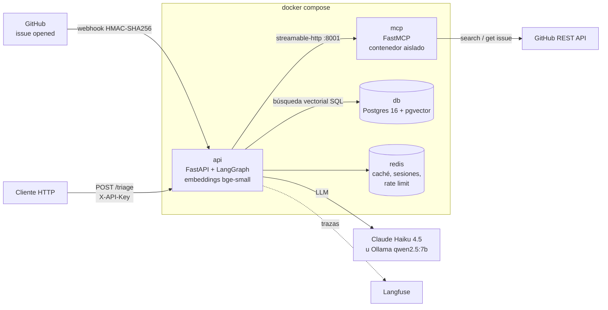
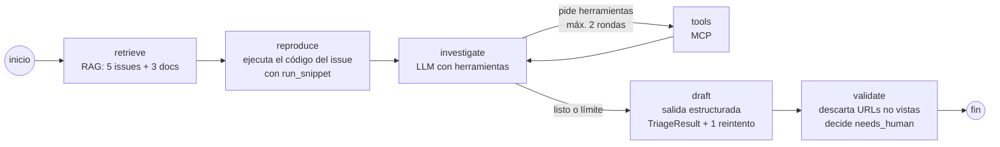
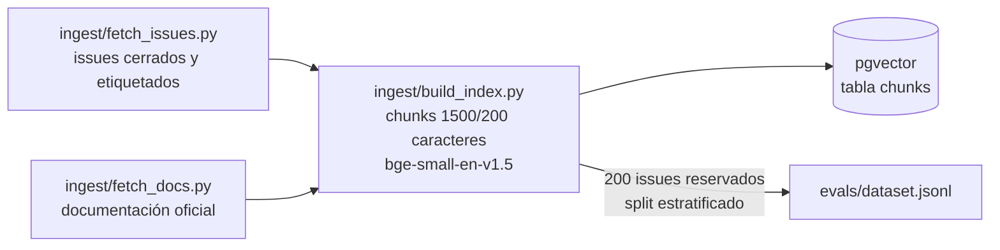

# Arquitectura de IssueTriage AI

IssueTriage AI recibe un issue nuevo de `pandas-dev/pandas`, lo clasifica (`Bug`, `Docs`, `Enhancement` o `Usage Question`), busca issues similares y la documentación relevante, intenta reproducir el código del reporte y devuelve una respuesta JSON con fuentes verificadas.

Este documento describe los componentes, el flujo del agente y las decisiones de arquitectura (ADRs) con la evidencia que las respalda.

## 1. Componentes

| Servicio | Responsabilidad | Código |
|---|---|---|
| `api` | Endpoints REST, autenticación, guardrails, agente LangGraph, RAG | `app/` |
| `mcp` | Herramientas del agente: `search_github_issues`, `get_issue`, `run_snippet` | `mcp_server/server.py` |
| `db` | Chunks de documentación e issues con su embedding (384 dim) e índice HNSW | `db/init/01_schema.sql` |
| `redis` | Caché de resultados (TTL 7 días), memoria de sesión (últimos 5 triages), rate limit por API key | `app/memory.py`, `app/security.py` |

**Endpoints** (`app/main.py`):

- `GET /health`: estado del servicio.
- `POST /triage`: triage síncrono. Requiere `X-API-Key` y aplica un rate limit de ventana fija (60 s) en Redis. Si un guardrail rechaza la entrada, responde 422.
- `POST /webhooks/github`: valida la firma `X-Hub-Signature-256`, acepta solo eventos `issues/opened`, responde 202 y hace el triage en segundo plano.

## 2. Flujo del agente

El agente es un grafo de LangGraph con pasos fijos y un único bucle acotado de herramientas (`app/agent.py`).

Antes y después del grafo, `triage()` aplica:

1. **Guardrails de entrada** (`app/guardrails.py`): rechaza issues fuera de dominio (no relacionados con pandas), recorta el cuerpo a 6000 caracteres y enmascara PII (emails y tokens de GitHub, Anthropic y AWS).
2. **Caché**: la clave combina la versión del prompt, el modelo y si la reproducción está activa, para que un cambio de configuración no devuelva resultados viejos.
3. **Memoria de sesión**: incluye en el prompt los últimos triages de la misma sesión (por ejemplo, `issue-<número>` en el webhook).

Los nodos tienen estas responsabilidades:

| Nodo | Qué hace | Por qué |
|---|---|---|
| `retrieve` | Busca 5 issues similares y 3 secciones de docs en pgvector; arma el prompt marcando el issue como contenido no confiable | Contexto con fuentes citables; mitigación de prompt injection |
| `reproduce` | Si el cuerpo trae un bloque de código, lo ejecuta siempre (sin esperar a que el LLM lo pida) | La diferencia entre "esperado" y "obtenido" es la señal más fuerte para separar `Bug` de `Usage Question` |
| `investigate` / `tools` | El LLM puede pedir herramientas de la lista blanca, con un máximo de 2 rondas | Información extra sin bucles infinitos ni costos sin control |
| `draft` | Genera un `TriageResult` validado por Pydantic; si el JSON es inválido, reintenta una vez con el error | Salida estructurada confiable |
| `validate` | Elimina duplicados y docs cuya URL no aparezca en la evidencia; marca `needs_human` si la confianza es menor que 0,6 o si la respuesta cita issues no verificados | Evita citar fuentes inventadas |

## 3. Ingesta e índice

Los 200 issues de evaluación se separan **antes** de indexar (`train_test_split` estratificado por etiqueta), así que el agente nunca encuentra en el índice el issue que se le está evaluando.

## 4. Decisiones de arquitectura (ADRs)

### ADR-001: PostgreSQL + pgvector como base vectorial

- **Estado:** aceptada
- **Contexto:** el RAG necesita guardar unos miles de chunks de dos fuentes (documentación e issues) con metadatos (URL, sección, número y etiqueta) y buscarlos por similitud, a veces filtrando por fuente.
- **Decisión:** usar Postgres 16 con la extensión pgvector (imagen `pgvector/pgvector:pg16`), con una única tabla `chunks`, un índice HNSW con distancia coseno (`m = 16`, `ef_construction = 64`) y un índice GIN sobre los metadatos `JSONB`.
- **Alternativas consideradas:**
  - *Chroma / FAISS*: simples para prototipos, pero los metadatos y los filtros son más limitados y no tienen la robustez de una base relacional.
  - *Qdrant / Weaviate*: bases vectoriales dedicadas con más funciones de búsqueda, pero son otro servicio que operar y aprender para un volumen que no las necesita.
  - *Pinecone*: servicio gestionado, pero externo y de pago, y rompe la regla de que el proyecto corra completo en local.
- **Consecuencias:**
  - ✅ Vectores y metadatos en la misma fila: el filtro por fuente (`WHERE source = 'issue'`) va en la misma consulta SQL que la búsqueda.
  - ✅ `UNIQUE (doc_id, chunk_index)` permite re-indexar sin duplicar.
  - ✅ Herramientas conocidas (`psql`, backups, SQL) y un servicio menos en el `docker-compose.yml`.
  - ⚠️ Con millones de vectores habría que ajustar HNSW o evaluar una base dedicada; con el volumen actual no hace falta.
- **Evidencia:** recall@5 de **76,65 %** sobre 167 pares issue–duplicado (`evals/results/retrieval_2026-10-01.md`), con búsqueda vectorial pura.

### ADR-002: LangGraph para orquestar el agente

- **Estado:** aceptada
- **Contexto:** el triage tiene pasos que **siempre** deben ocurrir (recuperar contexto, reproducir el código, validar la salida) y un paso que es abierto (investigar con herramientas). Un agente totalmente libre puede saltarse pasos, entrar en bucles o inventar fuentes.
- **Decisión:** modelar el agente como un `StateGraph` de LangGraph con nodos fijos (`retrieve → reproduce → investigate → draft → validate`), un único bucle condicional `investigate ⇄ tools` con un máximo de 2 rondas (`MAX_TOOL_ROUNDS`) y `recursion_limit = 12`.
- **Alternativas consideradas:**
  - *Agente ReAct libre (`AgentExecutor` de LangChain)*: menos código, pero el LLM decide todo el flujo y no se puede garantizar que se reproduzca el código o se valide la salida.
  - *CrewAI / multiagente*: pensado para varios roles que colaboran; aquí hay una sola tarea y añadiría complejidad sin beneficio.
  - *Bucle propio en Python*: control total, pero habría que reimplementar el estado, el enrutamiento, la ejecución de herramientas y la integración con trazas.
- **Consecuencias:**
  - ✅ Comportamiento predecible: los pasos críticos no dependen del LLM.
  - ✅ El enrutamiento es una función pura (`route_after_investigate`) y tiene pruebas unitarias (`tests/test_agent_routing.py`).
  - ✅ Langfuse muestra latencia y tokens **por nodo**, así que se ve dónde está el costo.
  - ✅ Proveedor de LLM intercambiable (`LLM_PROVIDER`): el mismo grafo corre con Ollama local o con Claude.
  - ⚠️ Más código que un agente de una línea y dependencia de la API de LangGraph, que cambia con frecuencia.
- **Evidencia:** con `claude-haiku-4-5` y el prompt v2, el agente logra **90 % de accuracy y F1 macro 0,899** en 40 issues etiquetados (`evals/results/run_claude-haiku-4-5_v2_repro1_n10.md`). Con el prompt v1 y el modelo local, la accuracy era del 27,5 %, sobre todo por salidas que no cumplían el esquema (`evals/results/run_v1_repro0_n10.md`); esto motivó el nodo `draft` con reintento y el nodo `validate`.

### ADR-003: MCP para exponer las herramientas del agente

- **Estado:** aceptada
- **Contexto:** el agente necesita herramientas con riesgos distintos: dos de lectura sobre la API de GitHub y una que **ejecuta código escrito por terceros** (`run_snippet`). Ejecutar ese código dentro del proceso de la API expondría los secretos (`.env`), la base de datos y Redis.
- **Decisión:** implementar las herramientas en un servidor **MCP** propio (FastMCP), desplegado como contenedor separado y consumido por la API con `langchain-mcp-adapters` por streamable-http. En local, sin Docker, el mismo servidor se lanza como subproceso stdio.
- **Alternativas consideradas:**
  - *Funciones Python con `@tool` dentro de la API*: lo más simple, pero `run_snippet` correría con los mismos permisos y secretos que la API.
  - *Microservicio REST propio para las herramientas*: daría el aislamiento, pero habría que definir y mantener los esquemas de cada herramienta a mano.
- **Consecuencias:**
  - ✅ Aislamiento: el código ajeno corre en otro contenedor, con sistema de archivos de solo lectura (`read_only`, `tmpfs` en `/tmp`), sin capacidades (`cap_drop: ALL`, `no-new-privileges`), con 1 GB de memoria y 100 procesos como máximo. Se ejecuta con `python -I` y un timeout de 30 s.
  - ✅ Sin secretos al alcance: el contenedor `mcp` no carga el `.env`, solo recibe `GITHUB_TOKEN` y `MCP_TRANSPORT`. Además, `run_snippet` lanza el subproceso con un entorno vacío (`_run_isolated`), así que el código del issue no ve ni ese token. Lo verifica `tests/test_mcp_sandbox.py`.
  - ✅ Protocolo estándar: cualquier cliente MCP (por ejemplo Claude Desktop) puede reutilizar las mismas herramientas sin cambios.
  - ✅ Defensa en profundidad: la API además filtra las herramientas con una lista blanca (`ALLOWED_TOOLS`).
  - ⚠️ Un salto de red y un servicio más que operar.
  - ⚠️ El bloqueo de módulos peligrosos en `run_snippet` es una expresión regular y se puede evadir; la protección real es el contenedor. El contenedor conserva acceso a la red porque lo necesita para la API de GitHub.
### ADR-004 (complementaria): no usar reranker en el RAG

- **Estado:** aceptada
- **Contexto:** se probó reordenar los 20 mejores candidatos de la búsqueda vectorial con un cross-encoder, una técnica que suele mejorar la precisión del RAG.
- **Decisión:** **no** usar reranker en el agente. `retrieve_reranked()` queda en `app/rag.py` solo para experimentos.
- **Evidencia** (167 pares, recall@5):

  | Configuración | recall@5 |
  |---|---|
  | Solo embeddings (bge-small-en-v1.5) | **76,65 %** |
  | + `cross-encoder/ms-marco-MiniLM-L-6-v2` | 51,50 % |
  | + `BAAI/bge-reranker-base` | 41,32 % |

- **Consecuencias:** menos latencia y un modelo menos en la imagen. La hipótesis es que los rerankers, entrenados con pares pregunta–pasaje, no capturan bien la similitud issue–issue. Habría que revisarlo si cambia el dominio o el tipo de consulta.

## 5. Limitaciones conocidas

- **`needs_human` alto (70 %)**: `validate` es conservador. Prioriza no publicar respuestas dudosas sobre automatizar más casos.
- **`Usage Question` vs. `Bug`**: es la confusión principal (3 de 10 preguntas de uso se clasifican como bug).
- **Latencia**: unos 19 s de media con Claude Haiku. El webhook la absorbe en segundo plano, pero `/triage` es síncrono.
- **Un solo repositorio**: el índice, los guardrails de dominio y las herramientas están pensados para pandas.
